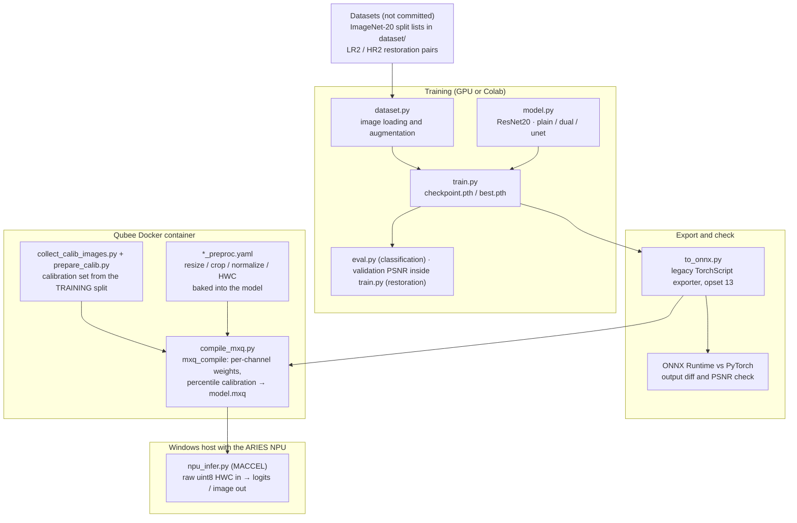
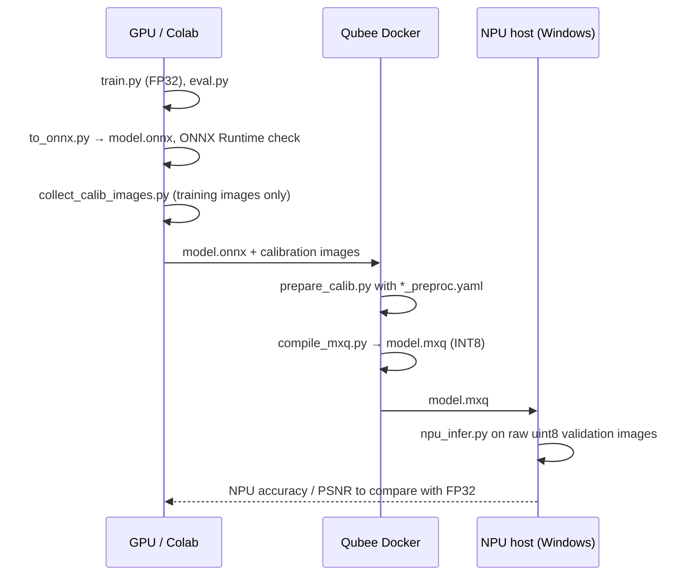

# edge-vision-npu

Two computer-vision models built from scratch in PyTorch and taken all the way to INT8 inference on a **Mobilint ARIES NPU**: an ImageNet-20 classifier and an image-restoration network. Each one is trained in FP32, exported to ONNX, checked against ONNX Runtime, calibrated and compiled to INT8 with Mobilint's Qubee compiler, and run on the NPU with the MACCEL runtime.

| Project | Task | Model | Result (FP32) |
|---------|------|-------|---------------|
| [`classification/`](classification/) | 20-class ImageNet subset, 240×240 input | `ResNet20`, residual CNN, 2.76M params, no pretraining | **77.40%** val accuracy |
| [`restoration/`](restoration/) | Restore degraded 256×256 images (blur, colour noise, JPEG blocking) | `DualScaleSR`, two-scale residual network, 2.66M params | **26.07 dB** val PSNR (input as-is: 25.12 dB) |

## Architecture



### Where each step runs



**How INT8 deployment works (briefly):**

The NPU computes in 8-bit integers, so every FP32 weight and activation has to be mapped to a small integer range. Qubee runs the ONNX model on a **calibration set** (training images, never validation) to see the real range of each layer's outputs. It then picks a scale per layer, clipping rare outliers at a percentile (default 0.9999) so the common values keep their precision. Weights get one scale per output channel. Preprocessing is compiled into the `.mxq` too, so the NPU takes a raw `uint8` image and no CPU-side normalisation is needed.

## Design choices

- **NPU-safe operators only.** The restoration models use just Conv, ReLU, Add, Concat and PixelShuffle (DepthToSpace), so the whole graph compiles to the NPU with no CPU fallback.
- **Identity at initialisation.** `DualScaleSR` has no BatchNorm. Residual branches are scaled down at init and the last conv starts at zero, so the untrained model returns its input exactly (25.12 dB) and training only has to learn the correction.
- **Metric matches the device.** Validation PSNR rounds and clips outputs to `uint8`, the same way the NPU output path does, so FP32 and NPU numbers are directly comparable.
- **Opset 13 on purpose.** `to_onnx.py` uses the legacy TorchScript exporter (`dynamo=False`). The newer dynamo exporter only emits opset ≥ 18, which the Qubee version used here doesn't accept.

## Prerequisites

- Python 3.10+ and a CUDA GPU (or the Colab notebook in `classification/`)
- Mobilint SDK, **not** on PyPI and not included:
  - `qubee` compiler, used inside the `mobilint/qbcompiler` Docker image
  - `maccel` runtime, on the Windows machine attached to the NPU

```bash
python -m venv .venv && source .venv/bin/activate
pip install -r requirements.txt   # torch, torchvision, numpy, pillow, onnx, onnxruntime
```

## Running

### Classification

```bash
cd classification
python train.py                  # SGD + Nesterov, cosine LR, 40 epochs → checkpoint.pth
python eval.py                   # per-class and overall accuracy
python to_onnx.py                # → model.onnx, input [1, 3, 240, 240]
python collect_calib_images.py   # balanced calibration subset from the training split
```

### Restoration

```bash
cd restoration
python model.py                  # sanity check: params, output shape, identity at init
bash compare_archs.sh            # train plain / dual / unet for 3,000 steps each
python train.py --arch dual --steps 60000 --out runs/dual_full
python to_onnx.py --checkpoint runs/dual_full/best.pth   # export + ONNX Runtime PSNR check
python collect_calib_images.py   # 200 calibration images from the training split
```

### Compile to INT8 (inside the Qubee container)

```bash
bash scripts/compile_in_docker.sh                 # classification: calib data + compile
python compile_mxq.py --onnx model.onnx --calib calib_data --out model.mxq \
    --mode 2 --percentile 0.9999                  # restoration; try 0.999 / 0.99 if PSNR drops
```

### Run on the NPU (Windows host)

```bat
scripts\npu_infer_windows.bat                     :: classification accuracy on the NPU
python npu_infer.py                               :: restoration mean PSNR on the NPU
```

Each folder's `NPU_RUNBOOK.md` has the exact commands for the NPU machine.

## Results

### Restoration: architecture comparison

Same budget for each: 3,000 steps, L1 loss, 128×128 crops, batch 16, EMA weights ([`restoration/results/compare.log`](restoration/results/compare.log)).

| Arch | Params | Val PSNR (FP32) |
|------|--------|-----------------|
| `plain` (16 ResBlocks @ 256²) | 1.22M | 25.973 dB |
| **`dual` (DualScaleSR)** | **2.66M** | **26.066 dB** |
| `unet` (3-level Res-UNet) | 4.85M | 26.033 dB |

ONNX export verified: ONNX Runtime PSNR = PyTorch PSNR = 26.066 dB.

### Classification

`ResNet20` reaches **77.40%** validation accuracy (FP32) on 20 classes with 300 training images per class and no pretrained weights.

## Status

- [x] Both models trained and exported to ONNX, ONNX Runtime output verified
- [x] Restoration architecture study (FP32): `dual` chosen
- [x] Qubee calibration and compile scripts, NPU inference scripts
- [ ] Measure INT8 accuracy / PSNR on the NPU and report the FP32 → INT8 gap
- [ ] Long restoration run + MSE fine-tune

## Repository layout

```
classification/   ResNet20 on ImageNet-20: train, eval, ONNX, calibration, compile, NPU infer, Colab notebook
restoration/      plain / DualScaleSR / Res-UNet: train, ONNX, calibration, compile, NPU infer, results/
requirements.txt  host-side Python deps (the Mobilint SDK is installed separately)
```

Datasets are not included; each project's README lists the expected layout.

## License

[MIT](LICENSE)
